# RetailPulse 360

[](https://github.com/khaledzidan203-stack/retailpulse-360/actions/workflows/ci.yml)

**End-to-End Multi-Branch Retail Sales & Business Intelligence Analytics**

> **PRE-RELEASE — Desktop QA pending.** Independent, entirely fictional portfolio: 30 stores, 2025–2026, fictional CUR currency. Headless generation, snapshots and Python/SQLite parity have been executed locally. Power BI refresh, DAX-engine parity and interactions have **NOT RUN** in this release session. This is not a final validated release. See [validation results](docs/VALIDATION_RESULTS.md).

## Business case

Retail leaders need consistent answers about sales, effective budgets, growth, store lifecycle and digital attribution. This project traces those answers from deterministic source snapshots through governed transformations and independent reconciliations to an 11-page Power BI report.

The fictional data demonstrates methodology, not actual company performance. No employer data, customer identities or private systems are required. License selection is pending; no open-source license is granted by this repository.

## Architecture and grain

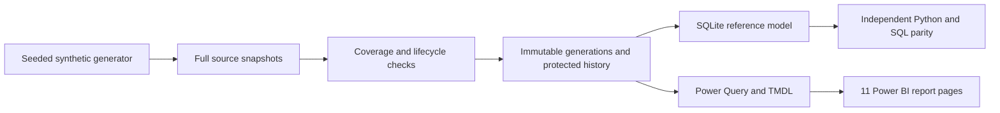

| Dataset | Business key / grain |
|---|---|
| Official sales and daily budget | Store × date × official channel |
| Marketplace attribution | Store × date × marketplace account |
| Monthly budgets | Store × month × official channel |
| Store operating calendar | Store × date |
| Account ownership | Account × effective date interval |
| Coverage | Source-family business key, explicit reported/missing state |

Python standard library handles generation, ETL, snapshot protection and SQLite. SQL provides an independent analytical reference. Power Query, DAX, TMDL and PBIR define the report. GitHub Actions executes the same headless commands.

## Governed definitions

- **Official Sales = Retail + Program.** Marketplace is attribution within Retail and must never be added to Official Sales.
- **Gap = Actual − Effective Budget. Achievement = Actual / Effective Budget.** Zero/absent denominator returns N/A; achievement may exceed 100%.
- Allocate monthly budgets over calendar days before applying lifecycle masks. Stop budget after closure; retain historical sales.
- Strict LFL uses the same eligible stores in each paired period and a ratio of aggregated totals, never average store growth.
- WTD is Saturday–Friday. Period totals and partial prior-year comparisons respect Official As-Of.
- Valid returns and negative days remain present. Zero, missing and invalid are distinct states.
- Digital matched comparisons use common covered dates/stores; later raw digital activity remains available separately.
- G0004 fictional dates: Official **2026-12-20**, Marketplace **2026-12-27**. These are synthetic scenario dates.

Authoritative definitions remain in [KPI contracts](docs/KPI_CONTRACTS.md), [data model](docs/DATA_MODEL_SPEC.md), [architecture decisions](docs/ARCHITECTURE_DECISIONS.md) and [snapshot contracts](docs/PHASE_3_ETL_SNAPSHOTS.md). Original document status headers are preserved as provenance; they are not current release approvals.

## Reproduce from source

Prerequisites: Git and Python **3.13.15** (validated Windows runtime; SQLite 3.50.4). No third-party runtime packages, SQL Server, Power BI Service subscription or private data is needed. Other Python/SQLite versions are not yet certified because existing validators pin exact generated database bytes.

```sh
git clone https://github.com/khaledzidan203-stack/retailpulse-360.git
cd retailpulse-360
python -m venv .venv
```

Activate the environment (`.venv\Scripts\Activate.ps1` in PowerShell, `source .venv/bin/activate` in a POSIX shell), then:

```sh
python -m pip install -r requirements.txt
python -B -m unittest discover -s tests -p "test_*.py" -v
python -B tools/validate_public.py
python -B tools/reproduce.py --output "../retailpulse build"
```

The output directory **must not exist** and must be outside the checkout. The bootstrap refuses overwrite. It produces `project/data/synthetic/`, `project/data/processed/p3_2/`, G0001–G0004 under `project/data/processed/p3_3/`, and `project/data/processed/p4_1/retailpulse360_g0004.sqlite`, plus separate local logs and `results.json`. The current generation stays G0004. Output contains a copied Power BI project; the source checkout remains unchanged.

All 190 output files (187 regenerated artifacts and 3 retained provenance fixtures) are compared to independently captured baseline SHA-256 values. The bootstrap executes lifecycle/seed checks, 20 snapshot scenarios and 8 atomic gates, 14 complete-input mutation cases at each of two generation transitions, SQLite financial checks, 37 KPI IDs over 13 scenarios, 12 arithmetic/date fixtures and generation refresh tests. Expected business totals include Official **3,759,335,807 cents**, Marketplace **514,398,580 cents**, and 36,438 Official fact rows. These are full-horizon totals, not the 2026-only screenshot totals.

See [reproduction details](docs/REPRODUCTION.md). Historical scripts are retained for traceability; use the supported bootstrap rather than running historical executables recursively.

## Open Power BI — zero manual path configuration

1. **Recommended first run:** On Windows, double-click `START_RETAILPULSE_360.cmd` from the GitHub clone. It automatically selects a fresh folder under your user profile, builds/tests the synthetic data and opens the generated PBIP. Or run `python -B tools/reproduce.py --output "../retailpulse build"` manually if you prefer choosing the output location. The bootstrap generates data, tests it, and **automatically configures the copied PBIP** with the output project's actual absolute path.
2. On Windows, **double-click `OPEN_POWER_BI.cmd` in the generated `project/` folder**. It re-detects the project directory, updates only the Power Query `pProjectRoot` parameter when needed, then opens the PBIP. No manual `Manage Parameters` step is necessary.
3. If you move the generated project to any other local folder or drive, close Power BI Desktop first and double-click `OPEN_POWER_BI.cmd` again. Its path discovery uses its own location, not the terminal's current working directory.
4. `pGeneration` stays `CURRENT`; the generated `CURRENT` pointer resolves the approved G0004 data. Run Refresh, then use the [Desktop runtime QA checklist](docs/POWER_BI_RUNTIME_QA.md).
5. The public source TMDL retains a deliberate `SET_LOCAL_BUILD_PROJECT_ROOT` placeholder so it never contains a developer's private workstation path. **Always open the generated PBIP**, not the source repo PBIP, for live data.

The launcher binds local paths **before Power BI Desktop opens**. Power Query `File.Contents` itself cannot infer the PBIP file's location; consequently, directly double-clicking a *moved* PBIP without the launcher is not supported. A first-time user may still need to approve local file permissions/privacy prompts in Desktop. No report visual, DAX expression, measure or approved design is changed by this setup.

## Report gallery

These are the user's existing actual report screenshots, copied byte-for-byte. All 11 were visually reviewed for fictional content and visible privacy issues; PNG metadata was checked. They are visual evidence, **not proof of current Desktop refresh or behavior**. Open an image to inspect at full resolution.

### 00 Index

[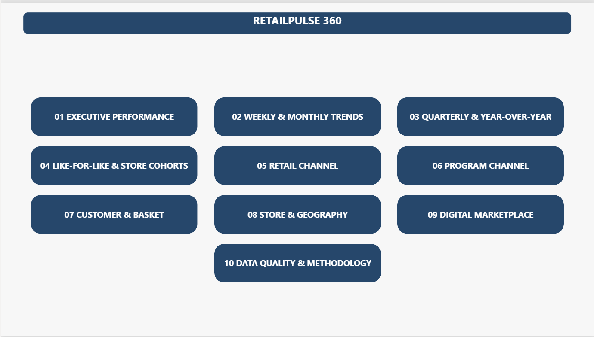](screenshots/00-index.png)

### 01 Executive Performance

[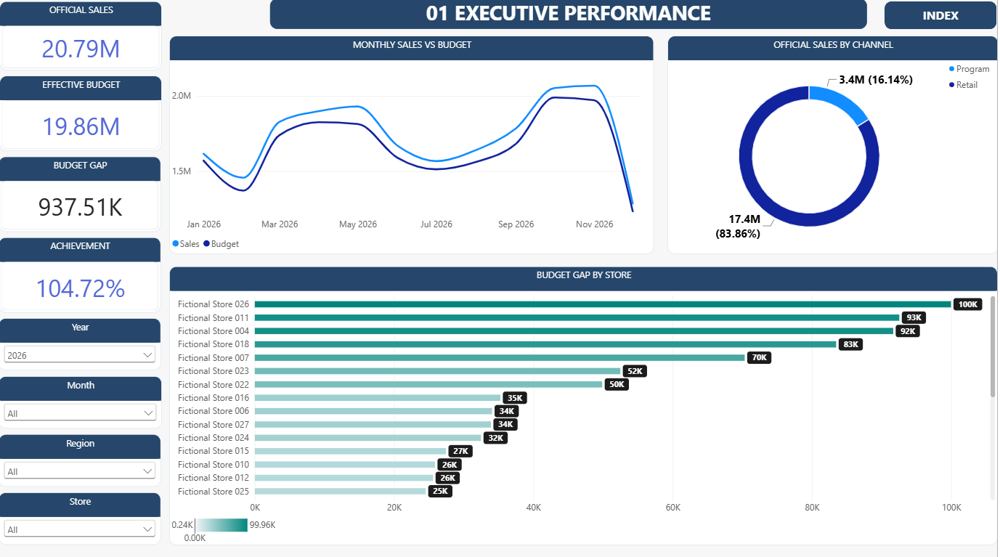](screenshots/01-executive-performance.png)

### 02 Weekly Monthly Trends

[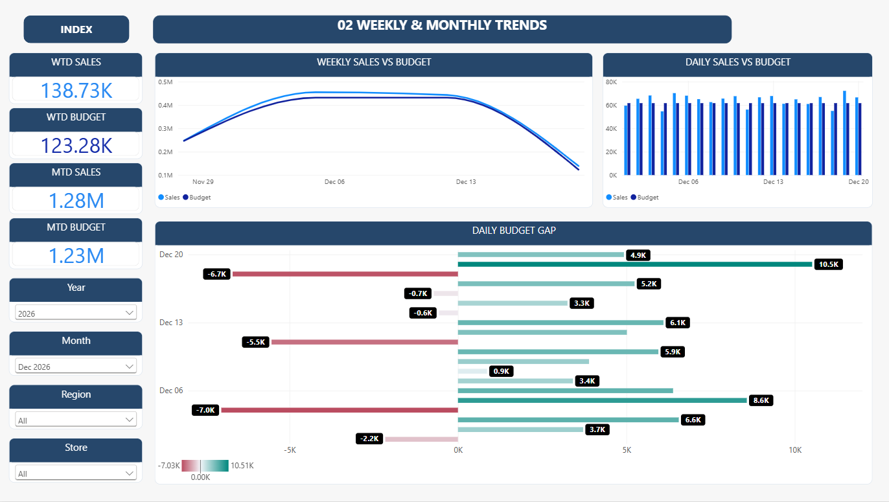](screenshots/02-weekly-monthly-trends.png)

### 03 Quarterly Year Over Year

[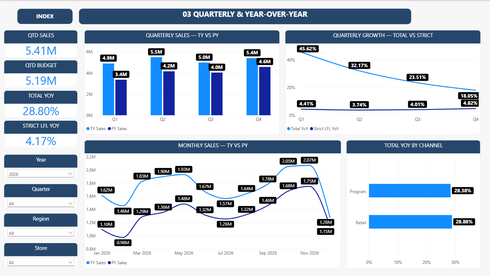](screenshots/03-quarterly-year-over-year.png)

### 04 Like For Like Store Cohorts

[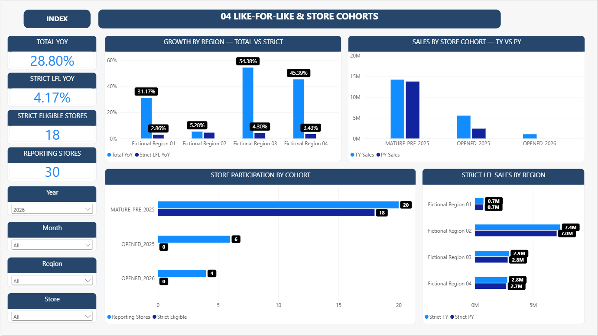](screenshots/04-like-for-like-store-cohorts.png)

### 05 Retail Channel

[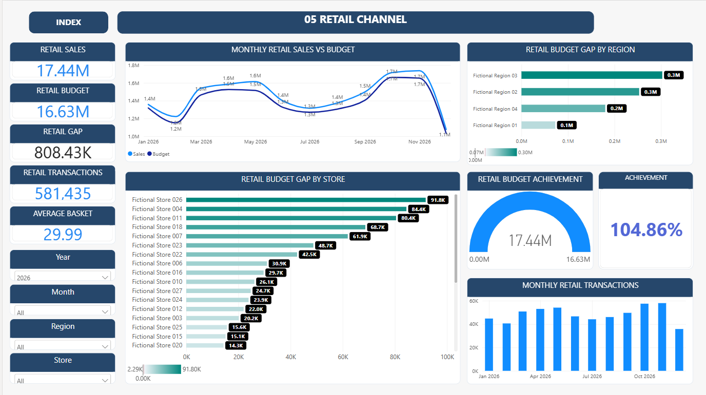](screenshots/05-retail-channel.png)

### 06 Program Channel

[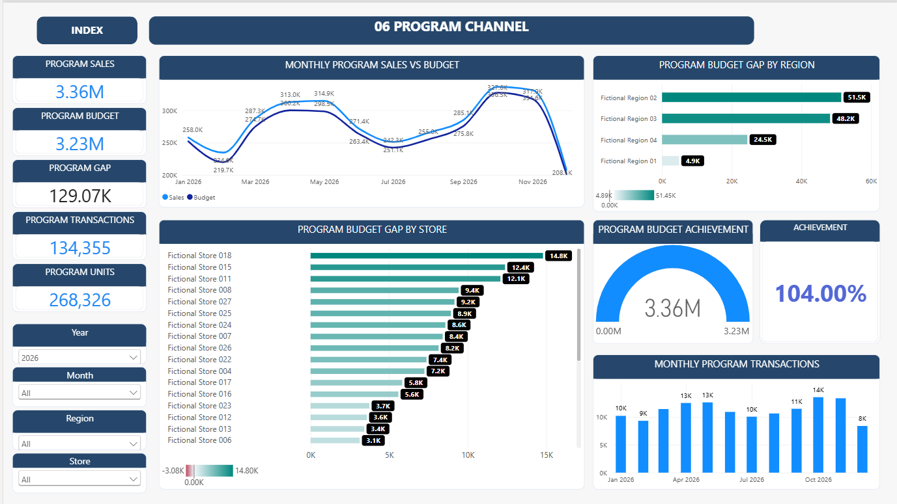](screenshots/06-program-channel.png)

### 07 Customer Basket

[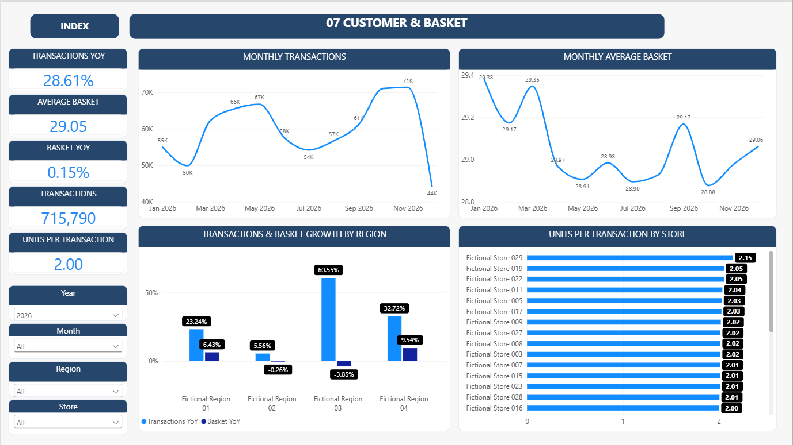](screenshots/07-customer-basket.png)

### 08 Store Geography

[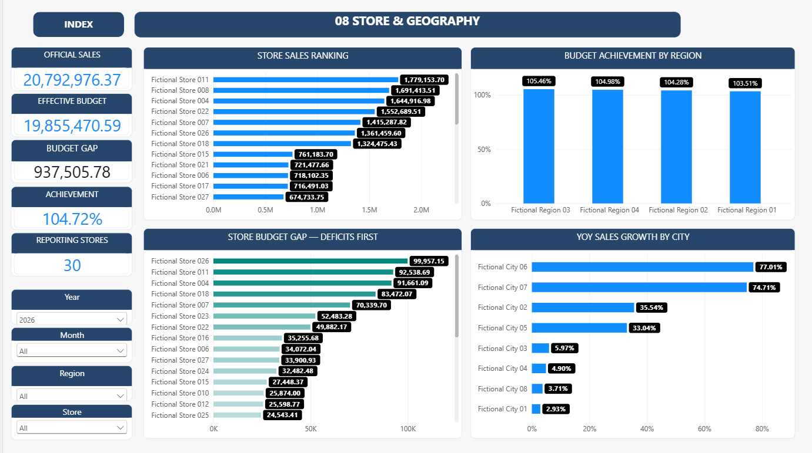](screenshots/08-store-geography.png)

### 09 Digital Marketplace

[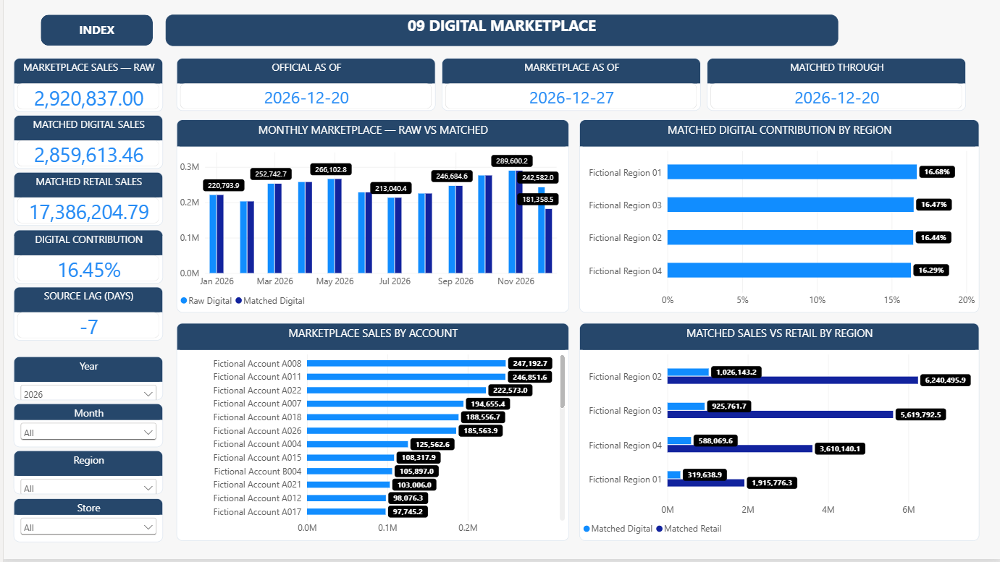](screenshots/09-digital-marketplace.png)

### 10 Data Quality Methodology

[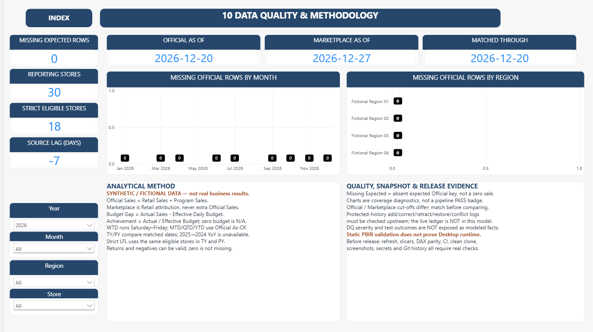](screenshots/10-data-quality-methodology.png)

## Validation, security and repository map

[Validation results](docs/VALIDATION_RESULTS.md) separate local checks, CI and pending Desktop work. [Privacy policy](docs/DATA_PRIVACY.md) describes the allowlist and full-byte scan; [file decisions](release/FILE_DECISIONS.md) explains exclusions. Do not commit generated output, PBIP caches, credentials or personal configuration. This portfolio accepts synthetic data only.

| Path | Purpose |
|---|---|
| `docs/` | Approved business contracts, reproduction and validation guidance |
| `src/retailpulse360/` | Snapshot, SQLite, KPI and retained historical engines |
| `sql/sqlite/` | Reference SQL and baseline comparison artifacts |
| `tests/` | Source integrity and KPI edge tests; small provenance fixtures |
| `PowerBI/` | Approved native report and semantic model |
| `screenshots/` | Eleven reviewed original screenshots |
| `tools/` | Supported isolated rebuild and publication checks |
| `release/` | File decisions and independently captured fidelity baselines |
| `.github/workflows/ci.yml` | Executable headless CI |

## Outcomes and transferable skills

This portfolio demonstrates financial reconciliation in integer minor units, snapshot correction/retraction with protected history, lifecycle-aware budgeting, period-specific comparable cohorts, temporal account mapping, explicit source coverage, independent SQL/Python validation and source-controlled BI design. It does not assert real-world commercial outcomes or final runtime certification.
